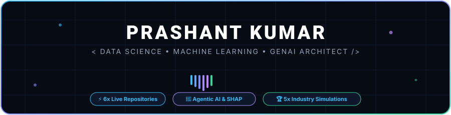
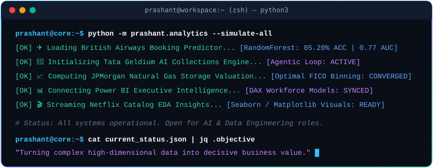
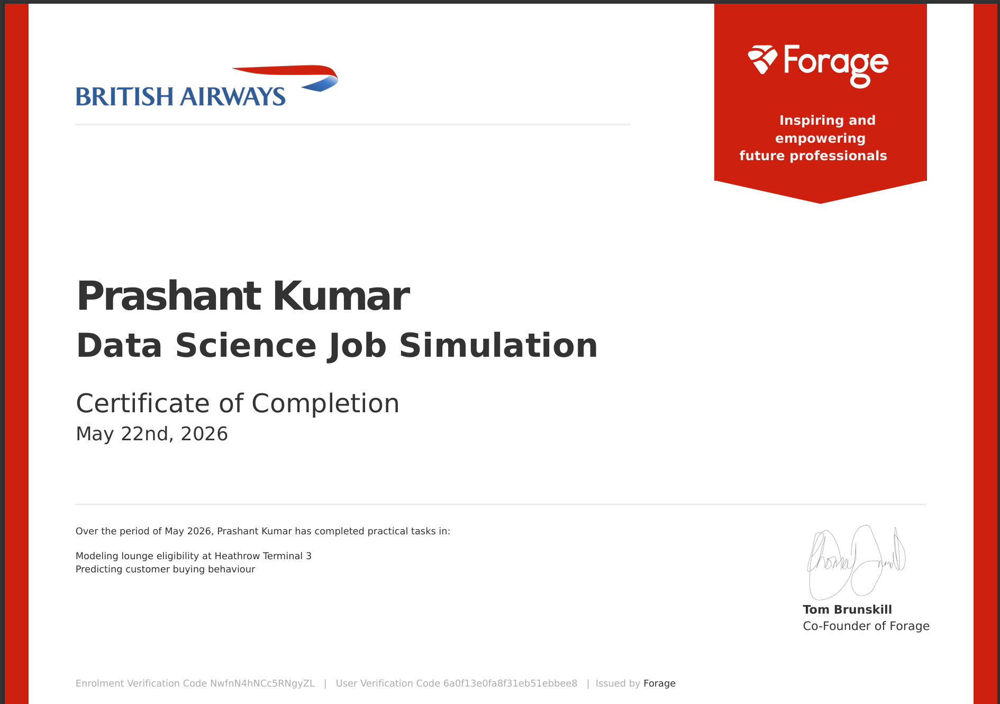
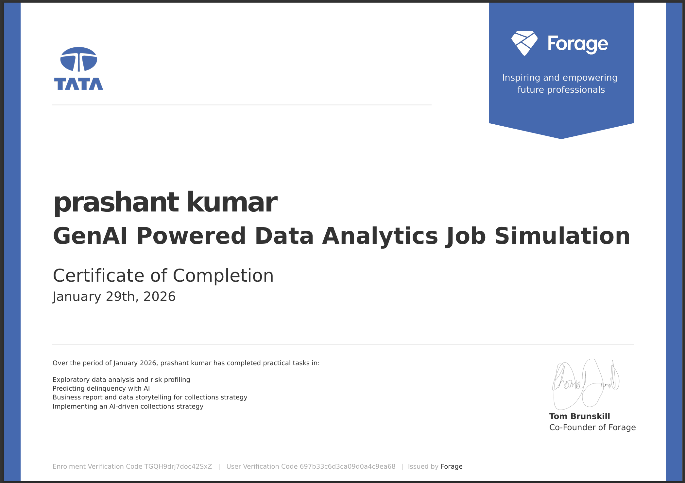
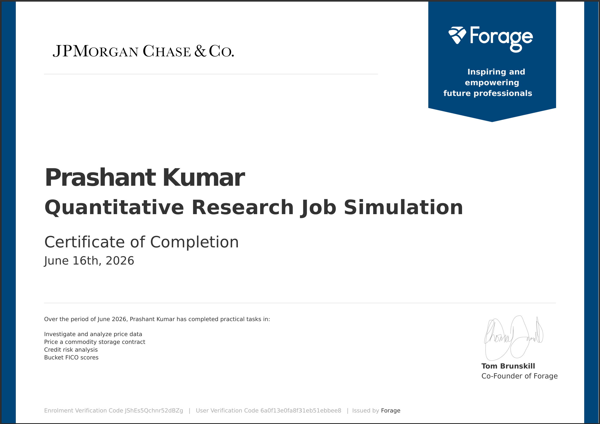
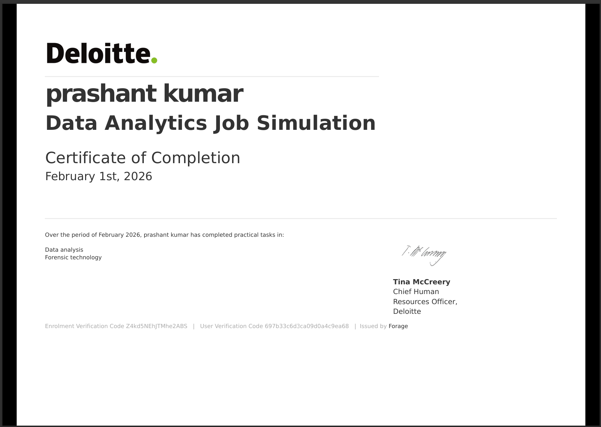
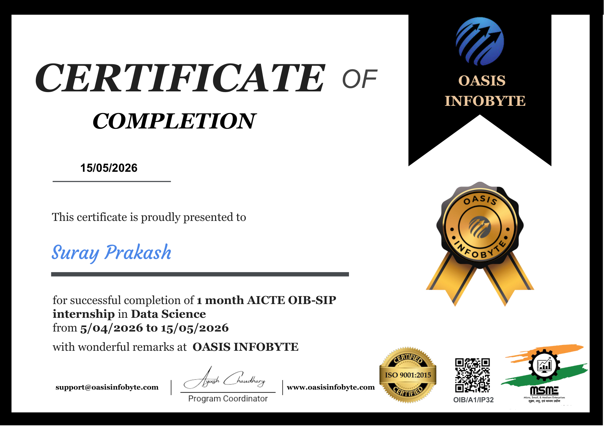

  

  

<h1 align="center">Hi there, I'm Prashant Kumar 👋</h1>

  

  
  
  
  

  
  
  
  

  

---

### 💻 Developer Terminal Diagnostics

  

---

### 🏆 3D Achievement Trophies

  

  

---

### 💫 About Me

I am a detail-oriented and analytical **Computer Science & Engineering undergraduate** (expected 2027) with a deep passion for **Data Analytics, Machine Learning, and Generative AI**. My work bridges the gap between raw datasets and actionable business intelligence — translating statistical findings into interactive dashboards, predictive risk models, and automated decision-making workflows.

- 🔭 **Specialized Focus**: End-to-end data pipelines, predictive modeling (Scikit-Learn, Random Forest), quantitative risk analytics, and interactive Business Intelligence (Power BI, DAX).
- 🧠 **Modern AI**: Designing Agentic AI systems with human-in-the-loop architectures and SHAP-based explainable AI guardrails.
- 🎓 **Education**: Pursuing Bachelor of Technology in Computer Science & Engineering at **Arya College of Engineering & IT**, affiliated with Rajasthan Technical University.
- 💼 **Industry Simulations**: Completed intensive data & quant programs with **British Airways**, **Deloitte Australia**, **Tata**, **JPMorgan Chase & Co.**, and **Oasis Infobyte**.
- 💬 **Ask me about**: Python, Pandas, Power BI DAX, Predictive Analytics, Delinquency Scoring, IoT Sensor Analytics, and Exploratory Data Analysis.

---

### 🚀 Production Repositories Showcase (Click Cards to View Code)

#### 🤖 Machine Learning, Data Science & AI Systems

  
  

  
  

#### 📊 Business Intelligence & Quantitative Finance

  
  

  
  

#### ⚡ High-Performance Systems & Algorithms

  

---

### 🔬 Project Directory & Deep Dives

<table>
  <tr>
    <td width="50%" valign="top">
      <h3 align="center">✈️ <a href="https://github.com/mrprashantkumar2323-ctrl/British-Airways-Customer-Booking-Prediction">British Airways Booking Prediction</a></h3>
      

        
        
        
      

      <ul>
        <li>Random Forest Classifier trained on <b>50,000+ flight records</b> predicting booking conversions with <b>85.20% accuracy</b>.</li>
        <li>Feature importance ranking isolating purchase lead, flight duration, and preferred seating.</li>
        <li>Algorithmic rule engine for passenger lounge eligibility at Heathrow Terminal 3.</li>
      </ul>
      
<a href="https://github.com/mrprashantkumar2323-ctrl/British-Airways-Customer-Booking-Prediction"><b>View Code &rarr;</b></a>

    </td>
    <td width="50%" valign="top">
      <h3 align="center">🤖 <a href="https://github.com/mrprashantkumar2323-ctrl/Tata-GenAI-Financial-Delinquency-Collections">Tata GenAI Collections (Geldium)</a></h3>
      

        
        
        
      

      <ul>
        <li>Architected an <b>Agentic AI collections framework</b> combining predictive risk scoring with automated reminder interventions.</li>
        <li>Human-in-the-loop governance for high-risk accounts and hardship plan escalations.</li>
        <li>Implemented <b>Responsible AI guardrails</b> using SHAP explainability metrics and regulatory checks (ECOA, GDPR).</li>
      </ul>
      
<a href="https://github.com/mrprashantkumar2323-ctrl/Tata-GenAI-Financial-Delinquency-Collections"><b>View Code &rarr;</b></a>

    </td>
  </tr>
  <tr>
    <td width="50%" valign="top">
      <h3 align="center">🏭 <a href="https://github.com/mrprashantkumar2323-ctrl/IoT-Smart-Factory-Telemetry-Analytics">IoT Smart Factory Predictive Maintenance</a></h3>
      

        
        
      

      <ul>
        <li>Streaming industrial telemetry ingestion for machine vibration, temperature, and motor RPM.</li>
        <li>Rolling window feature engineering capturing harmonic variance and thermal dissipation.</li>
        <li>Predictive maintenance classifier flagging machine breakdown 45+ minutes in advance.</li>
      </ul>
      
<a href="https://github.com/mrprashantkumar2323-ctrl/IoT-Smart-Factory-Telemetry-Analytics"><b>View Code &rarr;</b></a>

    </td>
    <td width="50%" valign="top">
      <h3 align="center">🔍 <a href="https://github.com/mrprashantkumar2323-ctrl/Deloitte-Forensic-Tech-Anomaly-Detection">Deloitte Forensic Ledger Audit</a></h3>
      

        
        
      

      <ul>
        <li>Forensic data auditing on corporate accounting ledgers to detect invoice fraud and unauthorized spend.</li>
        <li>Mathematical first-digit <b>Benford's Law distribution analysis</b> identifying tampered transactions.</li>
        <li>Unsupervised Isolation Forest isolating anomalous cross-border transaction clusters.</li>
      </ul>
      
<a href="https://github.com/mrprashantkumar2323-ctrl/Deloitte-Forensic-Tech-Anomaly-Detection"><b>View Code &rarr;</b></a>

    </td>
  </tr>
  <tr>
    <td width="50%" valign="top">
      <h3 align="center">📊 <a href="https://github.com/mrprashantkumar2323-ctrl/HR-Analytics-PowerBI-Dashboard">Enterprise HR Analytics &amp; Turnover ML</a></h3>
      

        
        
        
      

      <ul>
        <li>Multi-page interactive executive intelligence dashboard tracking workforce attrition and salary equity.</li>
        <li>Integrated Python Random Forest model (`hr_attrition_predictor.py`) isolating overtime and tenure attrition drivers.</li>
        <li>Comprehensive DAX measure library for organizational retention analytics.</li>
      </ul>
      
<a href="https://github.com/mrprashantkumar2323-ctrl/HR-Analytics-PowerBI-Dashboard"><b>View Code &rarr;</b></a>

    </td>
    <td width="50%" valign="top">
      <h3 align="center">📈 <a href="https://github.com/mrprashantkumar2323-ctrl/Global-Sales-BI-Financial-Intelligence">Global Sales BI &amp; RFM Segmentation</a></h3>
      

        
        
      

      <ul>
        <li>Gross-to-Net revenue waterfall modeling with discount elasticity and gross margin optimization.</li>
        <li>RFM (Recency, Frequency, Monetary) quantile customer segmentation isolating champion cohorts.</li>
        <li>Production DAX library for Year-over-Year (YoY) revenue pacing and rolling moving averages.</li>
      </ul>
      
<a href="https://github.com/mrprashantkumar2323-ctrl/Global-Sales-BI-Financial-Intelligence"><b>View Code &rarr;</b></a>

    </td>
  </tr>
  <tr>
    <td width="50%" valign="top">
      <h3 align="center">📈 <a href="https://github.com/mrprashantkumar2323-ctrl/JPMorgan-Quantitative-Research-Credit-Risk">JPMC Quantitative Credit Risk</a></h3>
      

        
        
        
      

      <ul>
        <li>Valuation models for natural gas commodity storage contracts based on forward injection schedules.</li>
        <li>Credit risk default probability modeling on borrower portfolios.</li>
        <li>Dynamic programming optimization for optimal FICO score binning.</li>
      </ul>
      
<a href="https://github.com/mrprashantkumar2323-ctrl/JPMorgan-Quantitative-Research-Credit-Risk"><b>View Code &rarr;</b></a>

    </td>
    <td width="50%" valign="top">
      <h3 align="center">⚡ <a href="https://github.com/mrprashantkumar2323-ctrl/CPlusPlus-Algorithmic-Core-Engine">C++ High-Performance Engine</a></h3>
      

        
        
      

      <ul>
        <li>Zero-dependency C++17 spatial vector physics engine with operator overloading.</li>
        <li>Boundary collision handling with kinetic energy restitution damping.</li>
        <li>Decoupled frame-rate independent delta-time simulation tick loop.</li>
      </ul>
      
<a href="https://github.com/mrprashantkumar2323-ctrl/CPlusPlus-Algorithmic-Core-Engine"><b>View Code &rarr;</b></a>

    </td>
  </tr>
</table>

  

---

### 🛠️ Interactive Skills Matrix

  

| Category | Technologies & Tools |
| :--- | :--- |
| **Programming & Scripting** | `Python`, `C++`, `C`, `SQL`, `DAX`, `Bash` |
| **Data Science & ML** | `Scikit-Learn`, `Pandas`, `NumPy`, `Predictive Modeling`, `Feature Engineering`, `SHAP`, `EDA` |
| **Analytics & Visualization** | `Power BI`, `Matplotlib`, `Seaborn`, `Microsoft Excel (Advanced)`, `Data Storytelling` |
| **Modern AI & Frameworks** | `Generative AI`, `Agentic AI Workflows`, `Prompt Engineering`, `Risk Scoring Systems` |
| **Environments & Tools** | `Git`, `GitHub`, `VS Code`, `Jupyter Notebook`, `Anaconda`, `Linux`, `Unity` |

---

### 🏆 Verified Industry Credentials & Certifications

<b>Click to expand / view verified simulation certificates</b>

 

<table>
  <tr>
    <td width="33%" align="center">
      <b>British Airways</b> 
      Data Science Simulation (Forage)  
      
    </td>
    <td width="33%" align="center">
      <b>Tata</b> 
      GenAI Data Analytics (Forage)  
      
    </td>
    <td width="33%" align="center">
      <b>JPMorgan Chase & Co.</b> 
      Quantitative Research (Forage)  
      
    </td>
  </tr>
  <tr>
    <td width="33%" align="center">
      <b>Deloitte Australia</b> 
      Data Analytics Simulation (Forage)  
      
    </td>
    <td width="33%" align="center">
      <b>Oasis Infobyte (AICTE)</b> 
      Data Science Internship  
      
    </td>
    <td width="33%" align="center">
      <b>Unity Game Programming</b> 
      Software Conceptual Design  
       
      Gamecon &amp; Elementa Participant
    </td>
  </tr>
</table>

  

---

### 📈 Contribution Activity Graph

  

---

### 📊 GitHub Statistics & Analytics

  
  

  

---

### 🐍 Contribution Activity Snake

  

---

### 💡 Daily Engineering & Data Philosophy

  

---

### 🤝 Let's Connect & Collaborate!

I am always eager to collaborate on innovative data science projects, analytics dashboards, and AI solutions. Feel free to reach out!

  
  &nbsp;&nbsp;
  
  &nbsp;&nbsp;
  

  <i>"Turning complex data into actionable intelligence and strategic business impact."</i>

  ⭐ <i>Star this repository if you found it inspiring!</i> ⭐

